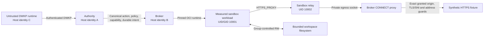

# M5d.5 — Agent-shaped workload and multi-identity evidence: implementation handoff

**Project:** [DireWolf](https://github.com/Onwcan/DireWolf)  
**Baseline:** `1c8ccbefc1cdc157a4385a1b3f0f36765b7dae8a` (`main`, verified 2026-10-23)  
**Verified hosted CI:** [run 39854518873](https://github.com/Onwcan/DireWolf/actions/runs/39854518873), **25/25 jobs successful**  
**Status:** **Planning handoff only. M5d.5 NOT IMPLEMENTED. No M5d.5 evidence executed.**  
**Authority of this document:** Technical plan, not an Accepted ADR; it does not approve any open owner decision.

## 1. Milestone boundary and source of truth

The contract is [ADR-0052](adr/0052-m5d-sandboxed-process-exec.md), particularly §§13, 17–19, and [ROADMAP.md](ROADMAP.md), M5d.5. The two deliverables are:

1. A **real agent-shaped, bounded, multi-process workload in `PROXY_ONLY`** with exact declared HTTPS origins, demonstrating both permitted traffic and denials through the existing mechanisms.
2. A **real three-identity hosted integration check**, using distinct host OS accounts for authority, broker, and untrusted DWKP runtime client, with actual OCI workload UID/GID 10001 and relay UID 10002.

The previous four checkpoints implemented the necessary primitives. They **do not** already prove the M5d.5 combination. M5d.6 separately handles run-release destruction, the gated `m5d-sandbox-exec` eval and ADR-0052 acceptance. M5e handles the broader adversarial closure, including package-manager registry scenarios. Neither belongs in this checkpoint.

The M5d.4 evidence was verified hosted green on the baseline SHA, but ADR-0052's text and the ROADMAP still contain historical "awaiting hosted CI" language. An implementing developer should update those status lines *without rewriting history* or declaring unapproved owner decisions approved. OD-3, OD-6, OD-12 and other decisions explicitly identified as pending remain pending until owner review. ADR-0052 stays **Proposed**.

## 2. Reusable implementation inventory

| Capability already present | Grounded location | Reuse / gap |
|---|---|---|
| Operator-attached production sandbox configuration | `crates/dwkd-authority/src/server/sandbox.rs` and `crates/dwkd-authority/src/sandbox.rs` | Supports `serve --sandbox-config` and `PROXY_ONLY`; no M5d.5 end-to-end agent evidence yet |
| Public sandboxed `process.exec` and workload lifecycle | `crates/dwkd-authority/tests/sandbox_workload.rs`; ADR-0052 §§2, 8–9 | Reuse real DWKP, released `serve`, start/collect, supervision, no replay |
| Agent-like workload with plan, workers and detached helper | `crates/dwk-sandbox-probe/examples/sandbox_fixture.rs`, `workload-agent` mode | Demonstrated previously under `NO_NETWORK`; positive `PROXY_ONLY` HTTPS not yet demonstrated |
| Network fixture operations | Same fixture, `egress-via-variable`, `egress-connect`, `egress-direct`, `egress-dns`, `egress-resolve`, `egress-env` | Reuse controlled existing evidence; distinguish proxy refusals from namespace denials |
| `PROXY_ONLY` relay, CONNECT proxy, measurement and grant enforcement | [ADR-0048](adr/0048-m5b-proxy-only-topology-and-connect-proxy.md); `crates/dwk-sandbox-relay/src/main.rs`; existing `sandbox-egress` evidence | Existing M5b evidence tests topology; missing workload-level integration in one run |
| Local HTTPS origin and synthetic PKI helpers | `crates/dwkd-authority/tests/secret_evidence.rs` (references `net_support::pki` and `net_support::Origin`); M5c evidence | Reuse only test-owned origins, trust anchors and evidence-only resolver paths; verify helper API before use |
| Separate-user broker and hostile-peer test patterns | `crates/dwkd-authority/tests/broker_foreign.rs`, `process_foreign.rs`, `fs_ops_foreign.rs`, `secret_evidence.rs`; `DW_BROKER_AS`, `DW_PEER_AS` | Extend existing OS identity practice with workload/relay checks; no same-UID substitute |
| Workspace mode/group and capacity enforcement | `crates/dwkd-authority/tests/sandbox_workload.rs`; `make sandbox-workspace-evidence`; [SANDBOX.md](SANDBOX.md) | GID 10001, root `2770`, real bounded filesystem; separate operator provisioning in hosted CI |
| Existing evidence runner and mutation conventions | `scripts/dw.py`, `Makefile`, `.github/workflows/ci.yml` | New case inventory, job, mutation campaign, aggregate dependency required |
| Policy/architecture and worker hardening | [ADR-0050](adr/0050-m5c-kernel-performed-net-http-ssrf-redirects-and-credential-egress.md) §21; [ADR-0053](adr/0053-d11-exchange-worker-confinement-and-secret-memory.md) | Real D11 uid-boundary evidence; never loosen startup posture to get a passing test |
| External coding-agent interoperability context | [ADR-0051](adr/0051-external-agent-interoperability.md) (Proposed) | **Not** a request to integrate a third-party product, ACP or MCP in M5d.5 |

**Discovery finding, not yet implementation evidence:** The earlier inspection reported Python TLS support in the existing tools image, with a relay addition potentially needed for `PROXY_ONLY` execution. Verify image content, actual digest pins, and CI reproduction before adopting this approach; do not add an unreviewed dependency merely for the fixture.

## 3. Intended integration flow

The runtime must not choose or fabricate the OCI environment, origin grant or trusted identity. Network and filesystem permissions are evaluated at their established boundaries. Evidence must not imply that each subprocess filesystem action receives a separate policy decision: the entire granted workspace is writable by the workload, per ADR-0052.

## 4. Proposed implementation work packages (unimplemented)

**A. Positive-path agent integration.** Reuse the already pinned fixture's multi-process behavior and run-scoped synthetic origin. Exercise one policy-authorized run through released `dwkd-authority serve --sandbox-config`, released broker, actual Docker runtime, measured `PROXY_ONLY` container, relay, CONNECT proxy and local HTTPS fixture. Keep process duration, output, data and cleanup bounded. Prefer reuse of the current fixture and TLS implementation; prove the client really receives a valid fixture response.

**B. Network restrictions.** Cover denied origin/port, invalid or mismatched CONNECT/TLS identity, direct networking, direct DNS, resource limits and tampered proxy variables through the *existing* ADR-0048 controlled fixtures and measured invariants. Attribute failures to the correct component. **Do not** alter production container network isolation in order to fabricate an escape; any isolated counterexample must be separately authorized and safely bounded. Record denied behavior and audit visibility separately, since not every denied syscall has a per-attempt audit event.

**C. Three separate Linux host users.** Adapt established `DW_BROKER_AS` and `DW_PEER_AS` CI convention. Use distinct numeric identities A/B/C; verify actual effective UID, GID and supplemental groups. Exercise real DWKP peer checks and private resource ownership using only temporary test state and synthetic secrets. OCI workload 10001 and relay 10002 remain separate sandbox identities, not substitute host users. Run required privileged cases only in a disposable hosted runner.

**D. Lifecycle and durability.** Reuse existing one-workload-per-environment, start/collect, output/deadline bounds, descendant `reap`, uncertain-outcome environment destruction and W8–W11 non-replay. Long-lived means a bounded invocation with children; persistent public handles or cross-invocation background services would require an OD-5 decision and are not assumed.

**E. CI, architecture and mutation evidence.** Add narrowly scoped `sandbox-agent-evidence` and `sandbox-agent` only when implemented. Use the existing mandatory-case recording model in `scripts/dw.py`, architecture fixtures, failure classification and byte-for-byte mutation restoration. A locally unavailable privileged case is NOT EXERCISED, never a PASS. Add the job to the aggregate CI `needs`; if exactly one job is added, expect **26** required jobs, but verify dynamically.

## 5. Required evidence matrix — planned, not executed

All entries below are **PLANNED / NOT EXERCISED** for M5d.5. Prior M5a–M5d.4 coverage may support a row but does not convert the new end-to-end row into PASS.

| Proposed case ID | Invariant / observable | Existing source to reuse | Evidence level and environment | M5d.5 state |
|---|---|---|---|---|
| A01-agent-production-route | Authenticated DWKP request reaches real measured sandbox, not host fallback | `sandbox_workload.rs` released-serve tests | Released authority/broker + real OCI | NOT EXERCISED |
| A02-agent-concurrency | Bounded agent creates plan, two workers and detached helper | `workload-agent` fixture | Real OCI, bounded filesystem | NOT EXERCISED |
| A03-https-allowed | Exact granted synthetic HTTPS origin succeeds through relay/proxy | ADR-0048 proxy, M5c local TLS origin | Real `PROXY_ONLY`, test PKI | NOT EXERCISED |
| A04-origin-denied | Ungranted origin or port is refused; origin not contacted | M5b CONNECT tests | Real controlled proxy fixture | NOT EXERCISED |
| A05-tls-identity | Mismatched target/SNI and invalid CONNECT are refused | ADR-0048 SNI/parser evidence | Real fixture, no public internet | NOT EXERCISED |
| A06-direct-transport | Direct TCP/UDP/DNS do not create an alternative route | Existing `egress-*` fixture modes | Real OCI namespace, recorded errno | NOT EXERCISED |
| A07-proxy-configuration | Invalid or replaced proxy settings cannot introduce a new path | ADR-0048 measurement | Real OCI / controlled negative | NOT EXERCISED |
| A08-budget-bounds | Per-origin connection/byte and workload limits are enforced | M5b + M5d.2 guards | Real OCI and proxy | NOT EXERCISED |
| A09-workspace-allowed | Authorized agent and broker access shared workspace as designed | M5d.4 workspace evidence | Group 10001 + bounded filesystem | NOT EXERCISED |
| A10-workspace-denied | Workload cannot access unrelated mounts or privileged state | M5d.4/M5a negative cases | Test-owned resources only | NOT EXERCISED |
| A11-descendants-cleaned | Ended agent leaves no child/daemon residue | M5d.2 `reap` | Real OCI, process census | NOT EXERCISED |
| A12-abnormal-cleanup | Timeout/uncertain cleanup destroys untrusted environment | W8–W11 and existing lifecycle tests | Real OCI + durable state | NOT EXERCISED |
| I01-three-host-identities | A/B/C are distinct non-root OS UIDs; workload/relay UIDs remain fixed | `broker_foreign.rs` and related tests | Hosted three-user Linux runner | NOT EXERCISED |
| I02-dwkp-authenticated-peer | Only configured C identity connects to authority; other UID refused | M3e transport evidence | Released serve + real credentials | NOT EXERCISED |
| I03-broker-peer-boundary | Runtime C cannot exercise broker private authority channel | Broker foreign-peer tests | Released daemons, 3 host UIDs | NOT EXERCISED |
| I04-private-state-boundary | Runtime C cannot read/modify temporary authority DB, audit, policy or synthetic secret fixture | M4e/M4b multi-user evidence | Temporary runner-owned fixture paths | NOT EXERCISED |
| I05-runtime-socket-boundary | Runtime C and workload cannot use privileged OCI runtime socket | M5a/M5d.2 existing checks | Real runner/container permissions | NOT EXERCISED |
| I06-ptrace-posture | Broker starts only under acceptable measured D11 posture; hostile runtime denied process inspection | ADR-0050 §21 and ADR-0053 | Hosted real identities and measured host state | NOT EXERCISED |
| I07-host-workspace-membership | A/B authorized group membership; C excluded; modes and quota measured | M5d.4 ownership evidence | Hosted provisioned filesystem | NOT EXERCISED |
| I08-restart-and-nonreplay | Identity-separated crash/restart does not repeat uncertain execution | M5d.2 W8–W11 | Released daemons, durable ledger | NOT EXERCISED |
| C01-evidence-accounting | Every required M5d.5 case reports a grounded result, no silent skips | `scripts/dw.py` | Local + hosted test runner | NOT IMPLEMENTED |
| C02-ci-mandatory | New job is required by aggregate CI and mandatory cases are exercised | `.github/workflows/ci.yml` | GitHub Actions Linux | NOT IMPLEMENTED |
| C03-mutation-review | Relevant identity, proxy and cleanup guards yield meaningful mutant kills | Prior security mutation infrastructure | Sequential local mutation campaigns | NOT IMPLEMENTED |
| C04-clean-teardown | Test-created containers, sockets, mounts, OS users and files removed; pre-existing preserved | Existing sandbox evidence cleanup | Hosted disposable runner | NOT EXERCISED |

**Evidence precision:** Each future result should identify whether it is a unit decision check, real-process permission refusal, measured OCI invariant, production DWKP end-to-end observation, or a mutation kill. Do not call a unit refusal "hosted three-identity proof". Do not call a logged network denial "per-attempt audit" unless there is a corresponding audit event.

## 6. Hosted CI and prerequisites

**Existing sources:** `.github/workflows/ci.yml` has separate `sandbox-egress`, `sandbox-workload`, `sandbox-secret`, `sandbox-workspace` and other mandatory jobs. `Makefile` and `scripts/dw.py` expose their evidence and mutation targets. Existing multi-UID suites already use `DW_BROKER_AS`, `DW_PEER_AS` and disposable sudo-enabled runners.

**Design for future `sandbox-agent` job:** Linux Docker Engine; controlled HTTPS origin, evidence resolver and test CA; pinned fixture/probe/relay images; three distinct non-root host accounts; the allowed workspace GID 10001; temporary bounded filesystem provisioned solely for evidence; actual released daemons and authenticated DWKP client. Require the job in aggregate CI. Read kernel posture, groups, mount capacity, network topology, audit outcomes and container/process census. Fail when an essential test was NOT EXERCISED. Restrict test-root actions to setup/teardown on an ephemeral runner. Do not change the operator/developer host's users or network posture.

**Local environment:** Previous discovery reports that the developer workstation lacks the privileged three-user provisioning needed for this new evidence. Those cases must remain NOT EXERCISED locally, not reported green. No new code or CI job has yet been run.

**No production-bypass allowances:** No new shared-UID override, caller-selected workload UID, widened address allowlist, relaxed TLS verification or weakened security assertions. The existing evidence-only trust and resolver mechanisms must remain explicitly evidence-only.

## 7. Objective completion gates

M5d.5 is complete only after an authorized implementation provides:

- A real end-to-end PROXY_ONLY workload making a successful request to one granted synthetic HTTPS origin and observed denials to non-granted destinations, with the correct enforcement attribution.
- Real distinct host OS identities A/B/C and actual workload/relay identities, demonstrated by kernel facts and authorized/denied access to test-owned resources.
- Verified multi-process cleanup, workspace boundaries and unchanged W8–W11 non-replay.
- Mandatory case inventory; targeted architecture/mutation regressions; full existing security gates; no omitted privileged hosted evidence.
- Green full GitHub Actions aggregate on the exact owner-committed SHA, with the new mandatory job fully exercised.
- Explicit owner review for any new OD-5 decision; no unapproved changes to Accepted ADRs.

**No above requirement has been declared passing by this document.** The verified 25/25 baseline establishes **M5d.4**, not M5d.5.

## 8. Residual risks and non-goals

- OCI containment is not a VM boundary; host root and the OCI daemon are trusted.
- The shared workspace group grants all its authorized members access to the grouped workspaces; it is not per-file policy isolation inside `process.exec`.
- A workload can alter its own control files within the workspace; subsequent reads are untrusted. Executed tools are confined by the sandbox, not by their binary names alone.
- Permitted HTTPS origins can receive data that a compromised workload intentionally sends; sandbox redaction cannot prevent transformed-secret exfiltration.
- The M5d.3 secret-inheritance residual for mode B/C descendants continues to apply.
- The proxy's measured topology is evidence of network boundaries; it does not imply that every denied packet is individually audited.
- Persistent cross-invocation agent handles are not included by default; keep one active workload per environment unless OD-5 is explicitly decided.
- M5d.6 run-release destruction, gated eval and ADR-0052 acceptance are **not** part of this handoff. M5e package-manager registry tests are also out of scope.

## 9. Document and owner-decision backlog

Before attempting implementation closeout, address the following documentation statuses in **Proposed** ADR-0052 and ROADMAP only:

- Mark M5d.4 hosted CI green on `1c8ccbe` / run `39854518873`; do not rewrite older checkpoint evidence.
- Continue explicitly distinguishing M5d.5 NOT IMPLEMENTED from the older `NO_NETWORK` agent fixture evidence.
- Request explicit owner decisions for OD-3, OD-6 and OD-12 rather than treating a green CI run as their automatic approval.
- For OD-5, recommend using existing bounded long-running invocations with children; reserve client-visible persistent handles for a separate owner decision if genuinely necessary.
- Keep ADR-0052 **Proposed**, ADR-0051 **Proposed**, and all Accepted ADR content unchanged.

## 10. Owner handoff / next responsible action

This file is ready for the repository owner to place at `docs/M5D5_IMPLEMENTATION_HANDOFF.md` and review. It is an implementation checklist, **not** the implementation or a security sign-off.

After adding the file, run the repository's documentation gate (`make docs`) and any required architecture/link checks. Do not claim those gates passed until run. The actual M5d.5 code, privileged CI job, evidence suite, mutations and hosted green result remain future work by an authorized development process.

For a documentation-only commit, use an accurate subject such as:

`docs(m5d.5): record agent and identity evidence handoff`

Do not use a `feat(m5d.5)` commit or mark the milestone complete solely because this document exists.
