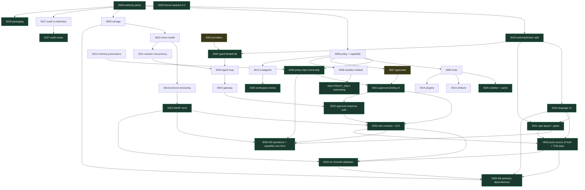

# Architecture Decision Records

Each ADR records one decision, the context that forced it, what it costs, what was rejected, and what would make us revisit it. An ADR without a "Revisit if" is an opinion wearing a costume.

**Accepted ADRs are immutable.** A changed decision produces a *new* ADR that supersedes or amends the old one; the old one stays, banner-marked, as a historical record. Phase 0.1 reconciliation produced twelve such ADRs (0018–0029) after adversarial review invalidated parts of the original set; M1 added 0030 (licence) and 0031 (repository layout and boundary enforcement); M2 added 0032 (the wire contract) and 0033 (protocol source of truth and TCB dependencies); the M2 closeout added 0034, which removed the protocol's dependence on a Unicode database; M3a added 0035 (what the authority plane is allowed to link) and 0036 (which DWKP operations M3 owns, and how a capability crosses the wire); M3b added 0037, which separates a capability as *declared* from a capability that authority is *compared with*; M3c added 0038, which gives policy an explicit second evaluation phase, restricts `extends` to a composition that cannot widen, and takes `would_require_approval` out of the caller's hands; M3d added 0039, which gives the authority durable state -- `kernel.db`, fenced epochs, durable admission, kernel-owned policy inputs and an audit chain written through a transactional outbox -- and records what that state costs the trusted computing base, SQLite's C included; the M3d reconciliation added 0040, which separates duplicate suppression from same-response replay across a tenure change, refuses a proposed action the authority cannot express as a complete canonical action instead of deciding it, and versions the three DWKP responses that changed; and M3e added 0041, which puts the authority behind a real process boundary -- a Unix-domain socket whose peers the kernel identifies before a byte is read, one fresh lease holder per connection, a handshake-first strict transport, and `rustix` in the measured TCB; and M4a added 0042, which decides what a declared filesystem path means -- the object found beneath an operator-bound root pinned by identity, by `openat2` relative to held descriptors, with symlinks, magic links, mount crossings and Unicode aliases refused, and the checked descriptor kept for the effect that M4b will perform; and M4b added 0043, which performs that effect -- `fs.read`, the first tool -- over a private channel on which the broker reads only from the authority's kernel-reported uid and the authority sends only to the broker's, with one read-only descriptor for the checked file, a single-use authorisation bound to a broker-issued channel instead of a MAC, a durable intent before the effect and a durable outcome and taint before the answer, and ADR-0018's blast-radius claim stated precisely; and M4c added 0044, which adds the other seven filesystem tools behind a canonical plan in which both gates decide every action, vacant targets as a second type, a broker that changes one validated name atomically and never an object it did not prove, a write permission for the broker's own uid stated as the ambient authority it is, and an `UNKNOWN` outcome that nothing ever performs again; and M4d added 0045, which adds process execution — an executable identity resolved from an absolute path and hashed, a broker that re-proves the descriptor the authority opened and executes that descriptor through a helper with an empty environment, limits and no surviving descriptor, bounded output, kill by pidfd and process group, broker generations — behind a host floor that needs a per-invocation approval, so that no production build launches anything before M6; and M4e added 0046, which makes secrets real without an API that returns one — an opaque handle whose meaning is its revision in `kernel.db`, the kernel keyring and age files read only after both gates passed and the intent is durable, the value handed to the broker once as the read end of a pipe and zeroed, a mode A render with no consumer and a mode B/C injection primitive with no production caller until M5, return-path redaction, daemons that dump no core, and the measured cost of all of it to the trusted computing base; and M5a added 0047, which builds the execution environment M5 stands on -- an `oci-strict` container prepared through the runtime client the authority hashed, measured from the runtime's record and by a digest-pinned probe inside it, usable only at the level every required invariant earns with no score, weakened profiles shown to be caught by the measurement, a durable lifecycle reconciled by exact label and durable record, and no public route to any of it; and M5b added 0048, which builds `PROXY_ONLY` -- an interface-free namespace whose one peer is a relay to the broker's opaque CONNECT proxy, reachable only by the relay's uid, enforcing the run's exact HTTPS grants, the IP guard on the whole answer, one pinned resolution, server-name agreement before the dial and byte budgets at the socket, with no TLS termination, no CA and no credential, every bypass measured as refused; and the M5b follow-up added 0049, which reads every peer's credentials through `nix` -- `rustix` 1.1.5 read a peer in a pid namespace the reader cannot see, pid 0, as undefined behaviour -- and records such a peer with no pid; and M5c added 0050, kernel-performed `net.http` -- the authority authorising every hop, the broker as the HTTPS client, a credential only at its bound origin, each hop's TLS and HTTP in a one-hop exchange worker whose narrowed residual the owner accepted with stated conditions; and the external-agent study proposes 0051 (Proposed): external coding agents are contained workloads or clients, never authorities, interoperability is ACP- and MCP-first and post-V1, and enforcement is claimed only where DireWolf contains the agent; M5d adds 0052 (accepted 2026-10-26): production sandboxed `process.exec` -- the authority decides every workload and records its intent first, the broker re-judges the measured environment, proves the executable's bytes and runs exactly the plan as the environment's own uid, the environment's init ends everything it left, and an uncertain ending destroys the environment; its six checkpoints, M5d.1 to M5d.6, are built and verified in hosted CI (the last at `d40bc25`, run 40310407743), with the owner's decisions recorded in it; and D11 hardening adds 0053 (accepted 2026-10-18): each HTTPS exchange worker installs an exact, measured syscall filter before it can receive anything and proves it, the broker vouches for it from the kernel before handing it anything, the start-up posture is read before every worker, a credential hop runs only where its memory cannot reach swap, and `net.http` runs only where that filter has kernel evidence (`x86_64`); and M5e proposes 0054 (Proposed): an evidence-backed npm profile for `workspace_exec_hygiene` -- `npm ci` and `npm install` of registry packages with scripts off and configuration pinned, everything else still refused, and npm fail-closed until hosted evidence passes and the owner accepts it; and its sibling 0055 (Proposed): pip's profile -- `pip install` of named wheels only, no build backend, configuration and trust pinned, everything else refused, and pip's behaviour unchanged until it is accepted; and M5e.2's finding F-R8 produced 0056 (accepted 2026-11-01): one environment's tasks bounded by its own pids cgroup and `RLIMIT_NPROC` -- counted per host uid across every environment -- raised to a backstop of 8 192 no set of environments the authority allows can reach, amending 0047 §5 and 0052 §10; the owner selected it (Option B) for implementation on 2026-10-31 and accepted it after its hosted evidence passed (run 41242001763 at `615e77e`), the shared host uid and its other residuals stated, not narrowed; and M5e.2's R3 proposed 0057: real `PROXY_ONLY` containers weakened one hard rule at a time were not built, so the closure was shown by real topologies, real `NO_NETWORK` weakenings, and the production judgement over a real runtime's own `PROXY_ONLY` record -- a residual, stated with what it left unverified; R-B (2026-11-01) decided that M5e.2 may not close with it: the real-container level stayed required, the residual was not accepted, and the record stayed Proposed as the statement of the gap until 0058 superseded it, never accepted; and M5e.2's E6 added 0058 (accepted 2026-11-09): each hard rule weakened in a real `PROXY_ONLY` environment the released broker prepares, by a test-only runtime that does not do what the plan asks, caught from both vantages and refused by the production decision -- built on 2026-11-08 and accepted after its hosted evidence passed (run 42525106398 at `14405ab`), superseding 0057; and E6's first hosted run found F-E6-HOSTNET, which added 0059 (accepted 2026-11-09): a `PROXY_ONLY` environment's setup and relay are made only once the runtime's record of the started environment shows a network namespace of its own -- built on 2026-11-08, before ADR-0058's acceptance, and accepted after the same hosted run, amending 0048's preparation order. **Do not cite a superseded ADR as current rationale.**

## Index

### Current (cite these)

| # | Decision | Relation |
|---|---|---|
| [0000](0000-authority-plane-separation.md) | The authority boundary is an OS process boundary | amended by 0018 |
| [0003](0003-agent-loop.md) | Two-dimensional run state — lifecycle state plus a wait set | — |
| [0009](0009-storage-strategy.md) | SQLite, two physically separate stores, no abstraction layer | — |
| [0010](0010-event-model.md) | Hybrid — relational entities, append-only transcript, chained audit | — |
| [0011](0011-session-concurrency.md) | Single-writer session actors with database leases and epoch fencing | a lease's end ends its reaped runs' environments, by 0052; point 2 (who takes a lease next) amended by 0063 |
| [0014](0014-artifact-model.md) | Large output becomes a kernel-owned, content-addressed artifact | — |
| [0015](0015-plugin-trust-model.md) | No plugins in V1; out-of-process with granted capabilities thereafter | — |
| **[0018](0018-authority-broker-split.md)** | **The authority plane is two processes — `dwkd-authority` and `dwkd-broker`** | amends 0000; authorisation mechanism and blast-radius claim amended by 0043; process execution by the broker amended by 0045; a secret value held by the broker for one invocation amended by 0046; the broker's one outbound path amended by 0048; a second outbound path, `net.http`, by 0050; workloads run by the broker, never as its own uid, by 0052 |
| **[0019](0019-language-rationale-v2.md)** | **Language rationale, revised for the authority/broker split** | supersedes 0001; dependency set amended by 0033 (and by 0035, 0039, 0041, 0046, 0049, 0050, 0053) |
| **[0020](0020-provider-request-path-v2.md)** | **Typed `ModelCall`; the kernel renders the provider request** | supersedes 0002 |
| **[0021](0021-approval-binding-v2.md)** | **Approval binding v2 — taint, privacy class and obligations are bound** | supersedes 0007; hash encoding amended by 0032; its field set by 0079 (the requester and the schema join it, the environment profile and the agent defined) |
| **[0022](0022-approval-response-authentication.md)** | **Approval responses are authenticated independently of the relay** | amends 0004; MAC encoding amended by 0032; its CLI-local and detached-local paths -- a terminal passed over the runtime's DWKP socket, `direwolf approve` as a DWKP peer -- withdrawn by 0077, which puts every local approval on the approver endpoint of 0067; neither path was ever built |
| **[0023](0023-dwkp-strict-schema.md)** | **DWKP rejects unknown fields; forward compatibility is for DWCP and the event log** | supersedes 0016 (DWKP part); made concrete by 0032 |
| **[0024](0024-sandbox-network-topology.md)** | **Sandbox networking is `PROXY_ONLY`, not `none`** | supersedes 0008 (network part); realisation (a loopback address in an interface-free namespace, not a veth pair) amended by 0048 |
| **[0025](0025-subagent-workspace-clone.md)** | **Subagent repo workspaces are independent clones, not linked worktrees** | supersedes 0013 (workspace part) |
| **[0026](0026-tool-visibility-and-cache-stability.md)** | **Tool visibility is fixed at admission and may only narrow** | supersedes 0005 (timing part) |
| **[0027](0027-audit-scope-boundary.md)** | **Audit covers brokered effects, not activity inside an authorised exec** | amends 0017 |
| **[0028](0028-policy-input-ownership.md)** | **Every policy input is derived and stored kernel-side** | amends 0006, 0012 |
| **[0029](0029-packaging-runtime-first-decoupled-authority.md)** | **DireWolf ships as a complete runtime; the authority plane is decoupled but not a separate product** | — |
| [0030](0030-licence-apache-2.0.md) | DireWolf is licensed under Apache-2.0 | — |
| [0031](0031-repository-layout-and-boundary-enforcement.md) | Repository layout, and how architectural boundaries are enforced in the build | refines 0018, 0019 |
| **[0032](0032-wire-contract-framing-strict-json-and-jcs.md)** | **The wire contract: framing, strict JSON, and RFC 8785 as the one canonical encoding** | amends 0021, 0022, 0023; key rule amended by 0034 |
| **[0033](0033-protocol-source-of-truth-and-tcb-dependencies.md)** | **Rust → JSON Schema → Python; the dependencies `dwk-proto` brings into the TCB** | amends 0019; §4 superseded by 0034 |
| **[0034](0034-protocol-depends-on-no-unicode-database.md)** | **No protocol decision consults a Unicode database; DWKP's unknown-field rule carries the property** | amends 0032, 0033; refines 0023 |
| **[0035](0035-m3-authority-dependency-set.md)** | **The M3 authority dependency set: SQLite, TOML, peer credentials and SHA-256 enter the TCB** | amends 0019, 0033, 0034; §3 (peer credentials through `rustix`) amended by 0049 |
| **[0036](0036-m3-authority-operations-and-the-capability-wire-form.md)** | **M3 defines AdmitRun, ReleaseRun and QueryAuthority; ToolInvoke stays reserved until a tool exists** | amends 0032; refines 0006, 0011, 0023, 0028, 0031; `AcquireLease`, `ReleaseLease` and `ReleaseRun` effect-bearing, still keyless, by 0052 |
| **[0037](0037-capability-specifications-and-canonical-authority-identities.md)** | **A declared capability and an authority-comparable capability are different types** | refines 0006, 0036 |
| **[0038](0038-policy-evaluation-phases-and-composition.md)** | **Policy evaluates in two phases, composes only by narrowing, and derives `would_require_approval` itself** | refines 0006, 0028, 0035 |
| **[0039](0039-durable-authority-state.md)** | **Authority state is durable, fenced and audited before it is returned; the kernel owns every policy input it decides on** | amends 0019, 0035; refines 0009, 0010, 0011, 0017, 0028, 0036; schema version 6 by 0046; schema version 8 by 0050; schema version 9 by 0052; schema version 14, ownership, by 0063; §10's producers of taint, schema version 13, by 0062 |
| **[0040](0040-m3d-reconciliation-admission-across-tenures-and-undecidable-proposals.md)** | **An admission key outlives its run but never replays it; a proposal the authority cannot canonicalise is refused, not decided** | amends 0036, 0039; refines 0011, 0023 |
| **[0041](0041-m3e-authenticated-dwkp-transport.md)** | **The authority serves DWKP on a Unix-domain socket to peers the kernel identifies; one fresh lease holder per connection** | amends 0019; records 0035 §3; refines 0000, 0011, 0018, 0028, 0029, 0032, 0039; the peer read amended by 0049; what a peer may act on amended by 0063; a second socket, the approver endpoint, by 0067 |
| **[0042](0042-m4a-canonical-filesystem-resolution.md)** | **A declared path means the object found beneath a pinned root, by descriptor, or nothing** | amends 0019, 0035, 0039; refines 0018, 0028, 0034, 0037, 0040 |
| **[0043](0043-m4b-private-broker-channel-and-brokered-fs-read.md)** | **The broker reads the object the authority checked, over a private channel only the authority can speak on** | amends 0018, 0036, 0039; refines 0028, 0032, 0037, 0040, 0041, 0042; private protocol, blast radius and retry decision amended by 0044; private protocol version 3 by 0045; version 4 by 0046; the broker's listeners and its outbound path amended by 0048; both ends' peer read by 0049; private protocol version 7 by 0050; private protocol version 8 by 0052; §9's read-family taint by 0062 |
| **[0044](0044-m4c-filesystem-operations-plans-and-atomic-mutation.md)** | **The filesystem tools: a canonical plan, every gate of every action, and atomic changes checked against the authorised object on both sides of the system call** | amends 0036, 0039, 0043; refines 0005, 0018, 0037, 0042; private protocol and blast radius amended by 0045; return-path redaction by 0046; §11's read-family taint by 0062 |
| **[0045](0045-m4d-process-execution-broker.md)** | **Process execution: the executable the authority hashed, executed from the descriptor the broker re-proved, and no production launch until approvals exist** | amends 0018, 0036, 0039, 0043, 0044; refines 0005, 0037, 0042; private protocol and process output amended by 0046; the helper's parent check by 0049; a second spawn site, the `net.http` exchange worker, by 0050; a process run in an execution environment by 0052; a host process's output taint by 0062 |
| **[0046](0046-m4e-secret-handles-backends-injection-and-redaction.md)** | **Secrets: an opaque handle, a value read only after both gates and a durable intent, handed to the broker once in a pipe, and redacted on the way back** | amends 0018, 0019, 0039, 0043, 0044, 0045; refines 0037, 0041; private protocol amended by 0047; mode A's consumer (and `broker.secret_egress` retired) by 0050; where mode A's credential memory may be, by 0053 |
| **[0047](0047-m5a-oci-execution-environment-and-measured-assurance.md)** | **The OCI execution environment: prepared through the hashed runtime client, measured from two vantages, usable only at the level its measurement earns, and reachable by no public caller** | amends 0018, 0039, 0043, 0045, 0046; topology, protocol, invariants and labels amended by 0048; the probe as the environment's init, and W5 at restart, amended by 0052; §5's `nproc` amended by 0056 |
| **[0048](0048-m5b-proxy-only-topology-and-connect-proxy.md)** | **`PROXY_ONLY`: an interface-free namespace whose one peer is a relay to the broker's opaque CONNECT proxy, which enforces the run's exact grants, the IP guard, one pinned resolution, server-name agreement and byte budgets** | amends 0018, 0024, 0043, 0047; refines NETWORK_SECURITY.md; its "Revisit if" on a sound peer read met by 0049; the IP guard and resolver shared with `net.http`, and a second dial site, by 0050; its preparation order (§§2, 10: the environment's record read before its peer is made) amended by 0059 |
| **[0049](0049-peer-credentials-read-soundly-through-nix.md)** | **Peer credentials are read through `nix`, soundly for a peer whose pid the kernel cannot name, which is then recorded with no pid and judged by its uid** | amends 0019, 0035, 0041, 0043, 0045; refines 0048 |
| **[0050](0050-m5c-kernel-performed-net-http-ssrf-redirects-and-credential-egress.md)** | **Kernel-performed `net.http`: the authority authorises every hop, the broker is the HTTPS client, and a credential reaches only its bound origin** | amends 0018, 0019, 0039, 0043, 0045, 0046, 0048; refines 0000, 0005, 0028; D11's exchange worker accepted with conditions (§21); the worker confined and vouched for, its start-up posture read per worker, its credential memory kept off swap, by 0053; §21's ptrace-posture prerequisite checked by the broker at start, by 0052; §5 step 6 (which obligations a hop keeps) by 0076 |
| [0051](0051-external-agent-interoperability.md) | External coding agents are contained workloads or clients of DireWolf, never authorities: ACP and MCP first, and enforcement claimed only where DireWolf contains the agent (**Proposed**) | plans post-V1 M29; refines 0020, 0024, 0029 (raises its revisit trigger as decision point DP-1), 0048 |
| **[0052](0052-m5d-sandboxed-process-exec.md)** | **Production sandboxed `process.exec`: the authority decides a workload, the broker runs exactly that plan in a measured `oci-strict` environment as the environment's own identity, and nothing of it outlives its invocation** | amends 0011, 0018, 0036, 0039, 0043, 0045, 0047, 0050; refines 0008, 0024, 0046, 0048, 0051; §10's per-environment task limits amended by 0056; §8 item 8 (a workload's outcome, and later reads of what it wrote) by 0062 |
| **[0053](0053-d11-exchange-worker-confinement-and-secret-memory.md)** | **D11 hardening: the HTTPS exchange worker confines itself with an exact syscall filter and is vouched for from the kernel before it is handed anything; a credential hop runs only where its memory cannot reach swap; `net.http` runs only where that filter has kernel evidence** | amends 0019, 0046, 0050; refines 0018, 0045, 0052 |
| **[0054](0054-m5e-npm-hygiene-profile.md)** | **An evidence-backed npm profile for `workspace_exec_hygiene`: `npm ci` and `npm install` of registry packages with scripts off and configuration pinned, everything else still refused** | amends 0052; refines 0048; evidenced by manual run 42879630675 at `05cdb51` |
| **[0055](0055-m5e-pip-hygiene-profile.md)** | **An evidence-backed pip profile for `workspace_exec_hygiene`: `pip install` of named wheels only, no build backend, configuration and trust pinned, everything else refused** | amends 0052; refines 0045, 0048; evidenced by manual run 42879630675 at `05cdb51` |
| **[0056](0056-m5e-cross-run-task-limit-isolation.md)** | **Cross-run task-limit isolation (finding F-R8): each environment's tasks bounded by its own pids cgroup, `RLIMIT_NPROC` raised to a host-wide backstop of 8 192 no set of environments the authority allows can reach** | amends 0047, 0052; refines 0048 |
| **[0058](0058-m5e-proxy-only-hard-rules-weakened-in-a-real-environment.md)** | **R3's E6 (M5e.2): each hard rule weakened in a real `PROXY_ONLY` environment the released broker prepared, by a test-only runtime that does not do what the plan asks, measured from both vantages and refused by the production decision** | supersedes 0057; refines 0047, 0048; refined by 0059; evidenced by hosted run 42525106398 at `14405ab` |
| **[0059](0059-m5e-proxy-only-peer-joins-only-its-own-network-namespace.md)** | **F-E6-HOSTNET (M5e.2): a `PROXY_ONLY` environment's setup and relay are made only once the runtime's record of the started environment shows a network namespace of its own (`HOST_NETWORK_ISOLATED`)** | amends 0048 §§2, 10; refines 0058; evidenced by hosted run 42525106398 at `14405ab` |
| [0060](0060-a-constrained-network-grant-gives-no-proxy-only-destination.md) | A `network.https` grant that carries a constraint gives a `PROXY_ONLY` environment no destination: an opaque tunnel can keep neither `methods` nor `max_requests`, so only an unconstrained exact grant becomes one (**Proposed**; finding F-19) | would amend 0048 §5 on acceptance; built 2026-11-12; hosted evidence observed on CI #201 ([PRE_M6_REMEDIATION](../PRE_M6_REMEDIATION.md)) |
| [0061](0061-workload-egress-decided-by-policy-novelty-and-exposure.md) | Each sandboxed workload's egress is decided by policy at launch -- by both gates, for every destination, by the run's novelty, the workspace root's exposure and the address's piece of the policy's ranges -- and held by the broker for the workload's life; the first origin byte on a root switches it to its exposed cells before it is forwarded (**Proposed**; finding F-17) | would amend 0048 §§5–7, 12 and 0052 §§5, 8 on acceptance; builds on 0060; built 2026-11-13; hosted evidence observed on CI #201 ([PRE_M6_REMEDIATION](../PRE_M6_REMEDIATION.md)) |
| **[0062](0062-taint-follows-delivered-content.md)** | **A run's taint follows the content it receives: a workload whose broker report says an origin byte reached it, or whose settlement cannot say, raises its run to `EXTERNAL_UNTRUSTED` whatever it printed; anything delivered from a workspace root that may hold network content raises it too; a run holding external content marks the root it changes before the effect; every rise records what it rests on, and a possibility is never taken for content received** (finding F-01) | amends 0039 §10, 0043 §9, 0044 §11, 0045 and 0052 §8, and 0061 (Proposed); store schema 13, private protocol and DWKP unchanged; built 2026-11-13; evidenced by CI #201 (run 44818094052 at `3998de2`) and every run since; accepted 2026-11-25 ([PRE_M6_REMEDIATION](../PRE_M6_REMEDIATION.md)) |
| **[0063](0063-principal-ownership-of-sessions-workspaces-and-profiles.md)** | **Sessions, workspaces and agent profiles belong to principals: the kernel-reported uid holds a session only as its owner or the operator's delegate, reaches a workspace only as its principal and names a profile only under the operator's grant; a new session is its first acquirer's, a legacy or bound one the operator's to declare; the migration grants nothing from history; a revocation ends leases and runs in one transaction and environments after it, `REVOKED` then `COMPLETE`; the runtime's endpoint receives no descriptor and M6's approver is an endpoint of its own** (finding F-18) | amends 0011 point 2, 0039 and 0041; store schema 14, private protocol and DWKP unchanged; built 2026-11-14; evidenced by CI #201 (run 44818094052 at `3998de2`) and every run since, three identities; accepted 2026-11-24 ([PRE_M6_REMEDIATION](../PRE_M6_REMEDIATION.md)) |
| [0064](0064-f02-authority-endings-serialised-with-decided-effects.md) | An end of authority waits for every effect already decided: one in-memory gate per store orders a revocation's first phase, a lease taken over or released and a run released after each file operation, host launch, `net.http` hop and sandboxed start standing between its decision and its outcome, on every handle; nothing ended reaches the broker after the end commits, and no new concurrency is enabled (**Proposed**; finding F-02) | would amend 0011 point 5 and 0039 on acceptance, refines 0063's concurrency residual; store schema 14, private protocol and DWKP unchanged; per-tunnel mediation designed, not built; built 2026-11-15; hosted evidence observed on CI #201 ([PRE_M6_REMEDIATION](../PRE_M6_REMEDIATION.md)) |
| [0065](0065-f03-effective-posture-is-reported-and-recorded.md) | Each daemon says its effective security posture control by control -- `ENFORCED`, `REDUCED`, `UNVERIFIED`, `UNSUPPORTED` or `NOT_APPLICABLE`, observed or configured, the flag that reduced it -- and no score; an acknowledgement is reduced whatever the host says at start, and a hop it admits against the host's facts is reported; the authority records its own posture in `audit.log` once per served incarnation and records the broker's as unverified (**Proposed**; finding F-03) | would amend 0053 §§4, 7 and 0039 on acceptance, refines 0017; store schema 14, private protocol and DWKP unchanged; the broker's posture in the authority's record designed, not built; built 2026-11-15; hosted evidence observed on CI #201 ([PRE_M6_REMEDIATION](../PRE_M6_REMEDIATION.md)) |
| [0066](0066-f12-host-path-anchors-are-placed-by-identity.md) | A policy path outside the workspace names a place on the host and is decided by where that place lies relative to the run's pinned root -- found by `(device, inode)` before each filesystem decision, never by its spelling: disjoint is no match, the root inside it is a match, it inside the root or unexaminable is unevaluated and denies; `~` stands for the homes the operator names (`--path-anchor home=`) and nothing else, the DireWolf anchors for the authority's own directories and the operator's; a host path only in a `DENY` rule (**Proposed**; finding F-12) | would amend 0042 §10 and 0038 on acceptance, refines 0028 and 0037; the shipped packs, DWKP, the private protocol and the store schema unchanged; `require_artifact_capture` still unenforceable (M8); built 2026-11-16; hosted evidence observed on CI #201 ([PRE_M6_REMEDIATION](../PRE_M6_REMEDIATION.md)) |
| **[0067](0067-f18-approver-endpoint-identity-boundary.md)** | **The approver is reached at an endpoint of its own, `--approver-socket`, by the uids the operator names with `--approver-uid` -- never a runtime's, the broker's or the authority's, with no override -- authenticated by the kernel before a byte is read; until M6's approval registry exists it holds no approval operation, records who connected and closes; no terminal descriptor is accepted anywhere, and every runtime claim of a human is undecodable** (F-18 Phase 3.4) | amends 0041, refines 0063 §8 and APPROVALS.md §7, proposes the requester's principal for 0021's binding in M6; DWKP, the private protocol and the store schema unchanged, two audit kinds; built 2026-11-16; evidenced by CI #201 (run 44818094052 at `3998de2`) and every run since, three identities; accepted 2026-11-24 ([PRE_M6_REMEDIATION](../PRE_M6_REMEDIATION.md)) |
| [0068](0068-f04-connect-proxy-peers-are-authenticated-by-kernel-uid.md) | The CONNECT proxy admits a connection only from the relay's uid (`RELAY_UID`), as the kernel reports it -- after `accept`, before a byte is read or a handler slot is held -- and closes any other uid, or a peer whose credentials cannot be read, unanswered and recorded; the pid is ignored (a relay's is invisible on Docker Desktop) and no gid is read; the directory's ACL stays, and either check alone refuses; a uid is not a process (**Proposed**; finding F-04) | would amend 0048 §3 on acceptance, meets 0049's revisit; DWKP, the private protocol, the store and every flag unchanged; built 2026-11-16; hosted cross-uid and hidden-pid evidence observed on CI #201 ([PRE_M6_REMEDIATION](../PRE_M6_REMEDIATION.md)) |
| [0069](0069-f05-user-namespace-and-lsm-assurance-are-measured-not-assumed.md) | An environment's user namespace and security-module confinement are read by the probe from its own kernel and judged by the broker against the runtime's record and the host's kernel, and reported -- never admitted on: the identity map is the contract and is never reported as remapping; AppArmor or SELinux counts as enforcing only where the host's kernel runs it and both vantages name the same enforcing profile or confined domain; Landlock, installed nowhere, never counts; remapping deferred, since the workspace, the task backstop, the relay's ACL and the proxy's peer check each refuse it (**Proposed**; finding F-05) | would amend 0047 §5 and the reading of `HOST_USERNS_NOT_HOST` on acceptance, refines 0052's and 0056's residuals; probe report version 4 (broker-internal); DWKP, private protocol 12, the store and every flag unchanged; built 2026-11-17; hosted evidence observed on CI #198 and CI #201 ([PRE_M6_REMEDIATION](../PRE_M6_REMEDIATION.md)); F-05 partially completed |
| [0070](0070-adr-0069-decisions-host-vantage-required-lsm-and-what-stays-deferred.md) | ADR-0069's four decisions: the container's user namespace is also read from the host's side (`/proc/<pid>/` of its first process, once its own control group names the container), so a native Linux host says `both` and a disagreement says `contradiction`; an operator may require AppArmor or SELinux (`--require-lsm`), and the broker then serves only where the kernel enforces it and refuses, as `UNSUPPORTED`, every environment not judged `ENFORCED`; remapping (no supported runtime offers per-container user namespaces), the authority's record (protocol 13) and Landlock (no confined worker opens a file; host execution is M6's) stay deferred with their prerequisites (**Proposed**; ADR-0069 OD-1 to OD-4) | would amend 0069 §§2, 4 on acceptance; DWKP, private protocol 12, its invariants, the store and every existing flag unchanged; built 2026-11-17; hosted evidence observed on CI #198 ([PRE_M6_REMEDIATION](../PRE_M6_REMEDIATION.md)) |
| [0071](0071-f06-an-operator-egress-allowlist-every-shipped-network-rule-requires.md) | Every shipped network rule (BALANCED's registries, POWER's HTTPS) also requires `destination_allowlisted`, which the authority computes from the operator's `--egress-allowlist` file -- one exact host, port and path (`net_http` or `workload`) per entry, strictly parsed, read like every operator file -- for every hop and every workload destination; without the file no shipped pack reaches any destination; the allowlist only narrows: grants, taint and novelty, the address guard and budgets still decide (**Proposed**; finding F-06) | changes the shipped packs' network rules and adds one `serve` flag and one predicate; DWKP, the private protocol, the store and operator policies unchanged; built 2026-11-17, hosted-verified on CI #198 (2026-11-20); OF-1 approved as implemented, OF-2 built as 0073 |
| [0072](0072-the-operators-model-library-is-offline-and-a-download-is-egress-the-authority-decides.md) | Managing model artifacts and running inference stay apart: `direwolf models` is an offline library the operator manages -- local GGUF and safetensors files imported, hashed (`LOCAL_DIGEST_ONLY`), identified by their own headers without running anything, verified, removed, sized against the host -- with no daemon, no DWKP operation and no network; downloads, search, pause/resume, Ollama and llama.cpp profiles are blocked until the authority has a `model_download` path and the broker a streaming operation (TX044) (**Proposed**; the owner's model manager request) | proposes a change to M7's scope; DWKP, the private protocol, the daemons and every policy unchanged; built 2026-11-18, offline only; tests passed on Linux, Windows and macOS on CI #198; OM-1 to OM-4 decided 2026-11-20 |
| [0073](0073-f06-of2-the-operators-egress-allowlist-is-a-ceiling-every-policy-is-under.md) | The operator's egress allowlist is a ceiling every policy is under: after a policy's rules the evaluator denies every network action whose exact host, port and path the operator's `--egress-allowlist` does not name -- whatever a shipped pack or an operator's own policy allows -- as the reserved `operator-egress-ceiling` (`OUTSIDE_EGRESS_ALLOWLIST`), which no file may declare; the input is computed once by the authority and no caller or run supplies it; a rule that denies keeps its name, and the grant, taint and novelty, the address guard and budgets still decide (**Proposed**; finding F-06, OF-2) | would amend 0071 §5; DWKP, the private protocol, the store and the packs unchanged; built 2026-11-20; hosted evidence observed on CI #201 ([PRE_M6_REMEDIATION](../PRE_M6_REMEDIATION.md)) |
| [0074](0074-f16-the-broker-resolves-the-decided-name-and-no-other.md) | The broker resolves the name the authority decided and no other: the host's resolver is asked for the absolute name (a trailing dot), so no search domain is appended and glibc's `/etc/hosts` lookup does not answer for it; an answer of more than 64 addresses is refused whole; nothing is cached; no DNSSEC is claimed (**Proposed**; finding F-16) | DWKP, the private protocol, the guard, pinning and every decision unchanged; built 2026-11-20; hosted: NOT EXERCISED on CI #201, no unprivileged namespaces on the runner; exercised from CI #209 on by `make namespace-evidence` in `sandbox-egress` ([PRE_M6_REMEDIATION](../PRE_M6_REMEDIATION.md)) |
| **[0075](0075-sr01-operator-policy-files-are-read-as-the-other-operator-files-are.md)** | **An operator's policy files are read as its other files are: an absolute path walked from `/` without a symlink, every directory one only root or the authority can change, the file regular, owned by root or the authority, writable by nobody else, bounded -- refused before it is read otherwise** (security review finding SR-01) | changes `--policy-file`'s operator contract; DWKP, the private protocol, the store, the packs and every decision unchanged; built 2026-11-22; evidenced by CI #209 (run 45056220111 at `f7f5aae`) and every run since; accepted 2026-11-22, recorded 2026-11-23 |
| **[0076](0076-isr2-01-audit-level-full-is-not-kept-on-a-net-http-hop.md)** | **`audit_level=full` is not kept on a `net.http` hop: the hop's record holds the URL as its digest and no header value or body, so a rule that asks for the request on record denies the hop `OBLIGATION_UNENFORCEABLE` instead of being counted as kept** (second security review finding ISR2-01) | amends 0050 §5 step 6; DWKP, the private protocol, the store and every other route unchanged; built 2026-11-23; evidenced by CI #212 and every run since (`net-http-evidence`'s `obligation-unenforceable` case); accepted 2026-11-25, OD-1 as written |
| **[0077](0077-the-approval-channel-is-the-approver-endpoint-and-an-approver-uid-is-a-principal-not-a-person.md)** | **Every local approval arrives on the approver endpoint and nowhere else -- ADR-0022's terminal over the runtime's socket and its `direwolf approve` as a DWKP peer are withdrawn -- and an approver uid is a principal, not a person: a dedicated approver account is assurance A1, a presence factor the kernel verifies is A2, and what A1 leaves unproven is said** (second security review findings ISR2-05, ISR2-06) | amends 0022 (CLI-local and detached-local withdrawn); refines 0063 §8, 0067 §5 and APPROVALS.md §7; OD-1 accepted 2026-11-24, OD-2 decided by 0078; nothing built: no approval operation exists before M6 |
| **[0078](0078-approval-assurance-which-classes-need-a2-and-the-presence-factor.md)** | **Which approvals need a person, not only a principal: host execution, `secret.use`, `fs.delete` and a standing grant's creation are approvable only at A2, a presence factor the authority verifies over the binding hash, and stay `DENY` until one is built and verified; every other class at A1; M6 does not enable host execution; the presence factor is a decision of its own, FIDO2 user presence its candidate** (ADR-0077's OD-2) | builds on 0077 §3, 0067 §7 and 0045's host floor; decides 0077's OD-2; nothing built; accepted 2026-11-24 |
| **[0079](0079-the-approval-binding-v1-what-it-binds-and-how-it-is-encoded.md)** | **The approval binding v1: thirteen members, each from a value the authority decided, resolved or recorded -- a file by device and inode, an executable by path and SHA-256, a host by name, port and pinned addresses, a sandbox by its configuration and measured assurance, the run's subject, agent profile and revision, its taint, the rule's scope with its resolved payload and only the obligations the route keeps -- encoded with RFC 8785, every integer a decimal string and every set sorted and duplicate-free, and refused, never defaulted, where a member is missing** (M6.1) | amends 0021 (its field set); DWKP, the private protocol, the store and every decision unchanged; built 2026-11-24 and committed as `b87f2d4`; nothing stores, asks for or spends a binding; evidenced by CI #225 (run 45492684496); accepted 2026-11-25, OD-1 to OD-5 as written |
| [0080](0080-the-approval-registry-durable-requests-and-atomic-consumption.md) | The approval registry: a launch denied `REQUIRE_APPROVAL` records a durable request naming its binding; a decision records an approval with a life and a use count; a use is spent only after its effect's intent and in its intent's transaction, every guard read again there -- the binding's bytes, the run, requester, session, tenure, policy revision, approver, assurance, expiry on a clock that never falls, a use left -- and the database refuses what no guard would write; revocation waits at ADR-0064's gate; M6.2 serves the sandboxed `process.exec` at A1 alone, and no path outside the authority can decide an approval (**Proposed**; M6.2) | builds on 0079, 0078, 0077, 0067 §7, 0064, 0063, 0062, 0052; would amend 0039 on acceptance (store schema 15); DWKP, the private protocol and the approver endpoint unchanged; committed `b8414fd`, CI #227 green ([M6_2_IMPLEMENTATION](../M6_2_IMPLEMENTATION.md)); M6.2.1's evidence built 2026-11-27, hosted run pending ([M6_2_1_SECURITY_EVIDENCE](../M6_2_1_SECURITY_EVIDENCE.md)) |

### Partially current (the unsuperseded parts still apply)

| # | Decision | What changed |
|---|---|---|
| [0004](0004-gateway-boundary.md) | The gateway is optional, holds no authority, and is four components | Approval-response authentication → 0022 |
| [0005](0005-tool-system.md) | Declarative registry, policy-driven visibility, no shell-string tool | Visibility *timing* → 0026 |
| [0006](0006-policy-and-capability-boundary.md) | Capabilities are the vocabulary; policy is the decision; both required | Input ownership → 0028 |
| [0008](0008-sandbox-default.md) | Sandboxed execution is the default; host execution is opt-in and loud | Network topology → 0024 |
| [0012](0012-memory-provenance.md) | Provenance gates promotion; memory can never alter authority | Storage of provenance → 0028 |
| [0013](0013-subagent-isolation.md) | Subagents are runs; capabilities attenuate; budgets are subtractive | Workspace mechanism → 0025 |
| [0016](0016-protocol-versioning.md) | Three protocols, additive evolution, forward-compatible readers | DWKP compatibility → 0023 |
| [0017](0017-observability-vs-audit.md) | Audit and telemetry are separate systems with different owners | Audit scope claim → 0027 |

### Superseded (historical record only)

| # | Decision | Superseded by |
|---|---|---|
| ~~[0001](0001-language-and-runtime.md)~~ | Controlled polyglot — Rust kernel, Python runtime, TypeScript UI | [0019](0019-language-rationale-v2.md) |
| ~~[0002](0002-provider-abstraction.md)~~ | Provider adapters shape requests; the kernel performs them | [0020](0020-provider-request-path-v2.md) |
| ~~[0007](0007-approval-semantics.md)~~ | Approvals bind to a canonical action, single-use, expiring, agent-bound | [0021](0021-approval-binding-v2.md) |
| ~~[0057](0057-m5e-proxy-only-real-container-evidence-residual.md)~~ | R3's real-container residual (M5e.2): `PROXY_ONLY`'s weakened-profile closure shown without real weakened `PROXY_ONLY` containers — never accepted (R-B, 2026-11-01), its limited claim never approved | [0058](0058-m5e-proxy-only-hard-rules-weakened-in-a-real-environment.md) |

## Reading order

**ADR-0000 first, then ADR-0018.** Together they answer *why* there is an authority boundary and *where it is drawn*. Everything else is downstream.

If you read only four: **0000** (why a kernel exists), **0018** (how it is split), **0028** (what the kernel must own for policy to mean anything), **0021** (how a human grants an exception).

## Dependency graph



Dashed nodes are superseded. `0001` is omitted from the graph because `0019` replaces it wholesale.

## Template

```markdown
# ADR-NNNN: <decision in one line>

**Status:** Proposed | Accepted | Superseded by ADR-MMMM · **Date:** · **Supersedes/Amends:**

## Context
What forces the decision. Evidence, constraints, what breaks without it.

## Decision
What we are doing. Specific enough to implement and to violate.

## Consequences
Positive AND negative. If there is no negative section, the analysis is incomplete.

## Alternatives considered
Each with a real reason for rejection. Steelman the strongest one.

## Revisit if
The observable condition that would make us change our minds.
```

## Rules

1. ADRs are **immutable once accepted**. Supersede or amend; never edit history. A superseding ADR must say what survived from the old one, not only what changed. Superseding happens through a new ADR and this index — the only part of an accepted record that stays writable is its `**Status:**` line, so the superseding ADR can banner-mark it. **This is enforced by `dwcheck adr`, in two layers:** the trust anchor is Git history, which compares each ADR against the content it had in the revision where it became Accepted — a revision no proposed change contains, and in CI the merge base with the target branch. [`accepted.sha256`](accepted.sha256) is the second layer and only a **tripwire**: it catches accidental drift and works with no history, but it lives in this same mutable tree, so one change can edit an ADR and re-run `dwcheck adr --record` together and the pair looks consistent. Adding an ADR means running `dwcheck adr --record` in the same commit. Correcting an already-accepted record needs an `[[adr.history_exceptions]]` entry in `architecture.toml` — the file, the exact content authorised, and the reason. The rule was broken once, in M2, by appending a dated note to ADR-0019; nothing caught it, which is why the check exists ([ADR-0034](0034-protocol-depends-on-no-unicode-database.md)), and that restoration is the one exception recorded today.
2. Any change to an interface of `crates/dwkd-authority` or `crates/dwkd-broker` requires an ADR or a note on an existing one. (The Phase 0 sketch called this directory `kernel/`; it is `crates/` — see [ADR-0031](0031-repository-layout-and-boundary-enforcement.md).)
3. Adding anything to `dwkd-authority`'s **transitive** dependency closure — which from M2 includes `dwk-proto`'s — requires a **new ADR that amends** [ADR-0019](0019-language-rationale-v2.md), as [ADR-0033](0033-protocol-source-of-truth-and-tcb-dependencies.md) does, and an entry in `architecture.toml`. Never append the note to ADR-0019 itself: that dependency set is a load-bearing claim, and the record of when it changed is worth more than the convenience of one file. `dwcheck deps` enforces the whole closure, not only the direct dependencies.
4. Adding a core tool requires a note on [ADR-0005](0005-tool-system.md) (the footprint ladder) and an update to the canonical inventory in [TOOL_SYSTEM.md](../TOOL_SYSTEM.md) §3.
5. **Every new DWKP operation requires a written argument for why it is not a second path from cognition to effect**, reviewed by someone other than its author, and a statement of whether it is an authority primitive or a runtime-shaped convenience ([ADR-0029](0029-packaging-runtime-first-decoupled-authority.md)). The argument lives in the operation inventory in `dwk-proto` and answers the eight questions in [CONTRIBUTING.md](../../CONTRIBUTING.md) "Changing the protocol".
6. Anything that could create a second path from cognition to effect requires an ADR that explicitly addresses [ADR-0000](0000-authority-plane-separation.md).
